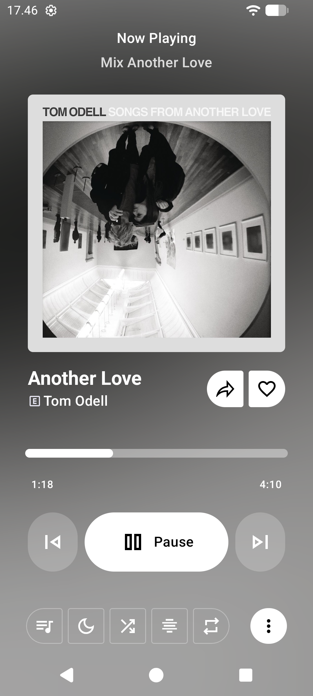
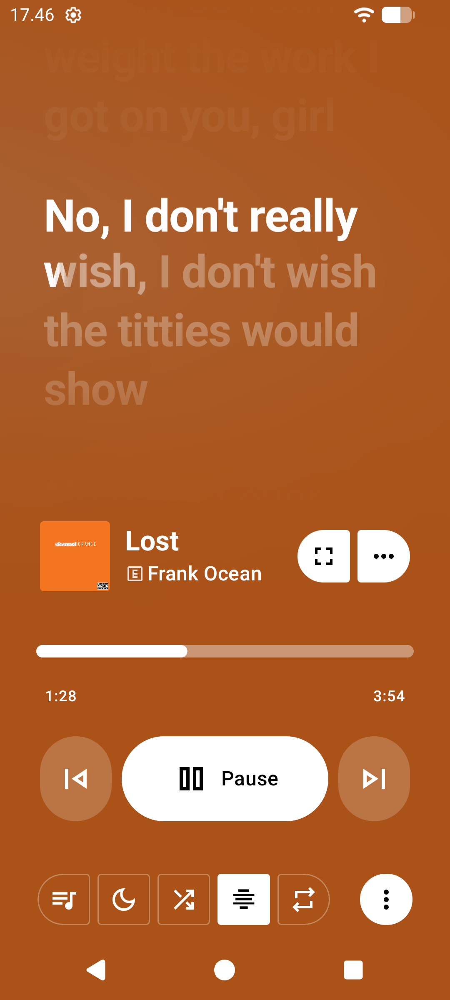
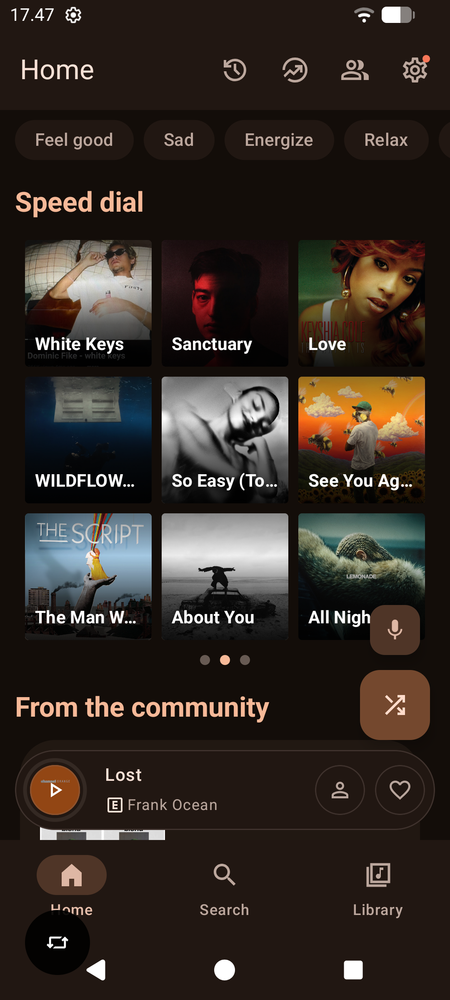

 

# VMusic

### Your music. Your vibe. 🎵

A community-driven YouTube Music client for Android, built around a refined listening experience, expressive design, and personalized music discovery.

 

[**Download**](#download) · [**Features**](#features) · [**Screenshots**](#screenshots) · [**Credits**](#credits) · [**Contributors**](#contributors) · [**Disclaimer**](#disclaimer)

---

> [!WARNING]
> **Regional Availability:** VMusic relies on YouTube Music services. Some features and content may be unavailable depending on your region, account, or Google's service restrictions.

> [!NOTE]
> VMusic is an independently maintained music player project based on Metrolist. It is not a continuation of the original ViMusic project.

## About VMusic

**VMusic is a music player for Android designed to make listening feel more personal.**

Built upon existing open-source work, VMusic develops its own identity through a refined interface, expressive navigation, immersive lyrics, and a customizable playback experience.

From discovering your next favorite track to following every lyric, VMusic aims to keep your music experience intuitive, fluid, and enjoyable.

- 🎧 **Listen your way** — enjoy music with background playback and customizable audio settings.
- 🎨 **Expressive by design** — experience a modern interface with Material 3 design elements.
- 🎤 **Feel every lyric** — explore synchronized lyrics with immersive animations and customizable lyric quotes.
- ⚡ **Made to feel fluid** — enjoy smooth transitions, animated backgrounds, and a streamlined navigation experience.
- 🌱 **Built to evolve** — explore an actively developed community project with room for new features and contributions.

---

<h2 id="screenshots">Screenshots</h2>

  
  
  

---

<h2 id="features">Features</h2>

*Everything you need for a more personal listening experience.*

### 🎵 Music Playback
- Stream music and videos from YouTube Music.
- Background playback.
- Offline downloads and caching.
- Skip silence.
- Sleep timer.
- Queue management and playback controls.

### 🎚️ Audio Experience
- Audio normalization.
- Tempo and pitch control.
- Equalizer.
- Crossfade.
- Customizable playback slider.
- Blurred player backgrounds with fluid animations.

### 🎤 Lyrics & Expression
- Live synchronized lyrics.
- Experimental lyrics presentation with Apple Music-inspired animations.
- Progressive lyric dimming and active-line transitions.
- Animated instrumental interval indicators.
- Lyrics translation, where supported.
- Lyrics Quote with multiple visual templates:
    - Default
    - FilmStrip
    - VinylRecord
    - MusicNote

### 🎨 Design & Personalization
- Material 3 interface.
- Material 3 Expressive Floating Capsule Menu.
- Animated navigation transitions.
- Light, dark, black, and dynamic themes.
- Dynamic colors and preset palettes.
- Customizable interface and playback preferences.
- Experimental Features for optional features under development.

### 📚 Library & Discovery
- Search songs, albums, artists, videos, and playlists.
- Personalized music recommendations.
- Library management.
- Local playlists.
- Playlist importing.
- Reorder songs in playlists and queues.
- YouTube Music account integration.
- Synchronization of songs, artists, albums, and playlists.

### 🌐 Connected Listening
- Listen together in real time.
- Last.fm scrobbling.
- Home screen widget.

### 🛠️ Built for Contributors
- Kotlin-based Android application.
- Lyrics Quote template contribution support through Kotlin Template DSL.
- GitHub Releases integration for stable version checks.
- Separate FOSS and GMS (Cast) APK variants, where available.
- Acknowledgments for the original project and its contributors.

> [!NOTE]
> Feature availability may vary by build variant and release. Some features may require compatible services, account access, or additional configuration.

---

<h2 id="download">Get VMusic</h2>

**Your next listening experience starts here.**

Download the latest available build from the official VMusic repository.

- **Stable releases:** [Download VMusic](https://github.com/antoneeh10/VMusic-app/releases)
- **Development builds:** [View GitHub Actions](https://github.com/antoneeh10/VMusic-app/actions)

### Available Variants

- **FOSS** — the build intended for use without Google Mobile Services dependencies where supported.
- **GMS (Cast)** — the build intended for Google Mobile Services integration and casting support.

Check the release notes and APK filenames before downloading to ensure you choose the appropriate variant.

---

<h2 id="credits">Credits & Acknowledgments</h2>

### The Foundation Behind VMusic

VMusic is derived from **[Metrolist](https://github.com/MetrolistGroup/Metrolist)**, an open-source YouTube Music client for Android.

The original project and its contributors provided the foundation upon which VMusic continues to evolve. Their work remains an important part of this project's history.

- **Original project:** [Metrolist](https://github.com/MetrolistGroup/Metrolist)
- **Original source code:** [Metrolist repository](https://github.com/MetrolistGroup/Metrolist)
- **Original contributors:** [View contributors](https://github.com/MetrolistGroup/Metrolist/graphs/contributors)

### Project Maintainer

**Ardian** — VMusic lead developer.

VMusic maintains its own application identity, package namespace, interface customizations, and project direction while acknowledging the upstream work it builds upon.

### Open-Source Ecosystem

VMusic also benefits from third-party libraries, frameworks, and integrations maintained by the open-source community.

Please refer to the applicable source repositories, license files, and third-party notices for their respective licenses and attributions.

---

<h2 id="contributors">Contributors</h2>

**Every contribution helps VMusic grow.**

### VMusic Contributors

Thanks to everyone contributing to the development, testing, and improvement of VMusic.

  

### Upstream Contributors

We also recognize the developers and contributors behind Metrolist whose work helped make VMusic possible.

  

### Contribute to VMusic

Want to help improve VMusic?

- Report bugs and unexpected behavior.
- Suggest features and interface improvements.
- Submit code contributions.
- Help improve documentation and translations.
- Create new Lyrics Quote templates using the Kotlin Template DSL.

Check the repository for contribution guidelines and open issues before submitting changes.

---

<h2 id="disclaimer">Disclaimer</h2>

VMusic is an independently maintained music player project based on Metrolist. It is not a continuation of the original ViMusic project.

VMusic is an independent, community-driven project. It is not affiliated with, sponsored by, authorized by, or endorsed by YouTube, YouTube Music, Google LLC, or their affiliates.

VMusic is derived from Metrolist and builds upon its existing open-source work. Credit for the original work remains with the original authors and contributors.

YouTube, YouTube Music, Google, Android, and other referenced trademarks belong to their respective owners.

---

### VMusic

**Your music. Your vibe.**

Made with ❤️ by the VMusic community.

[GitHub Repository](https://github.com/antoneeh10/VMusic-app) · [Releases](https://github.com/antoneeh10/VMusic-app/releases) · [Report an Issue](https://github.com/antoneeh10/VMusic-app/issues)

